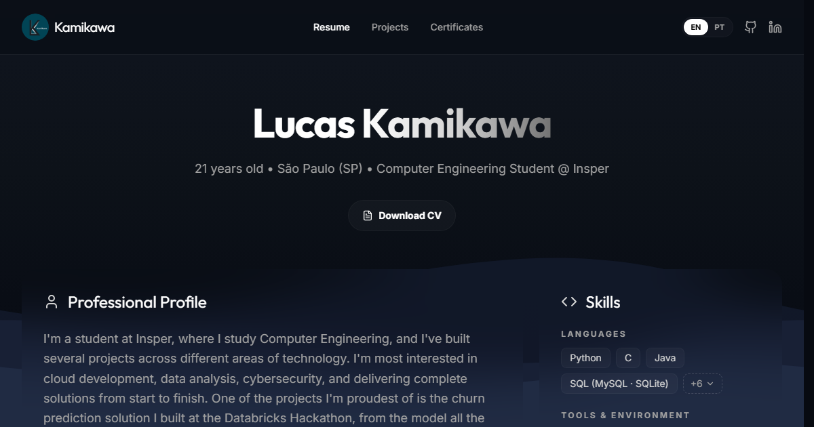

# Lucas Kamikawa · Portfolio

Personal portfolio of Lucas Kamikawa, Computer Engineering student at Insper (São Paulo).

**Live:** https://lucaskmk.github.io/

## What's inside

- **Home:** profile, current internship, skills, featured projects and the CV in English and Portuguese.
- **Projects:** projects grouped by area (AI, data, cloud, backend, systems, cybersecurity and hardware), with links to code, demos and reports.
- **Certificates:** AWS, Google Cybersecurity and other certificates and badges, each one viewable in full size.
- **English and Portuguese:** the whole site switches language from the toggle in the header.

## Stack

React 19 · TypeScript · Vite · Tailwind CSS 4 · Motion · React Router · lucide-react

Hosted on GitHub Pages from the `gh-pages` branch.
